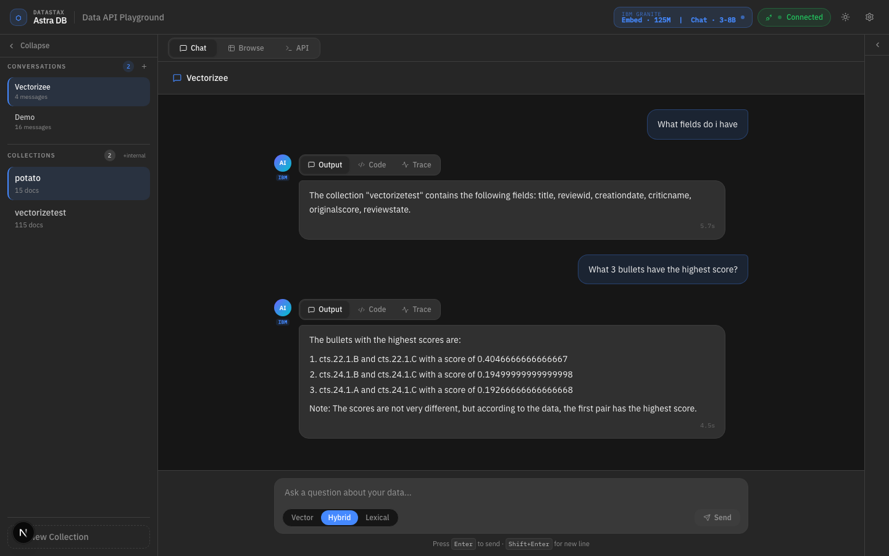
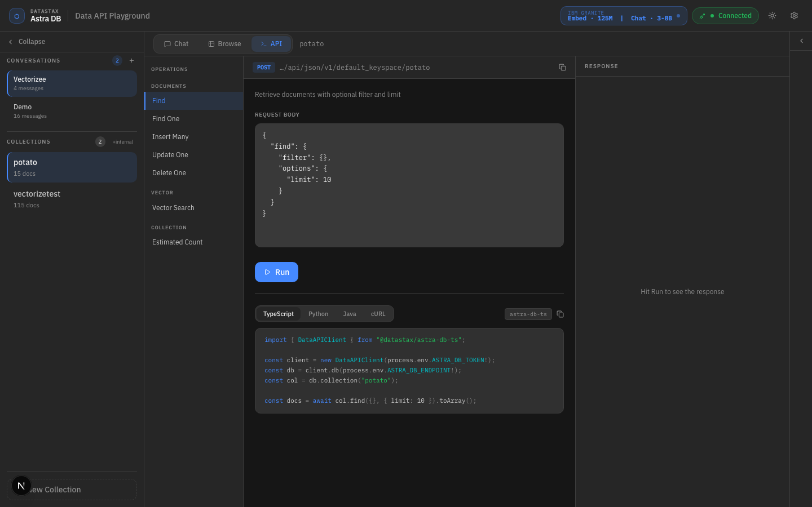

# Data API Playground

An interactive web app for exploring [DataStax Astra DB](https://www.datastax.com/products/datastax-astra) via the Data API. Connect to your database, chat with your data, inspect the underlying API calls, and ingest tabular or document data from the browser.

<p align="center">
  
  
</p>

<p align="center"><em>Move between conversational exploration and API-first inspection without leaving the playground.</em></p>

## Highlights

- Demo mode or live Astra DB connection
- AI chat with a streaming pipeline trace
- API explorer with generated request bodies, SDK snippets, and a live TypeScript client-call log
- Hugging Face when a key is available
- Local Ollama fallback when no Hugging Face key is configured
- CSV and document ingest with streaming progress
- Ingest workspace with a local document library and raw collection browser
- Visible Ollama prepare and download steps during first-run model setup
- Automatic server-side `$vectorize` support for vectorize-enabled collections
- Persistent conversations and ingested-document metadata in local SQLite

## AI Backend Behavior

All AI work flows through a shared provider layer in `src/lib/ai/service.ts`.

Resolution order:

1. Manual Hugging Face key entered in the Connect dialog
2. `HUGGINGFACE_API_KEY` from the server environment
3. Local Ollama fallback

Default models:

- Hugging Face chat: `Qwen/Qwen2.5-Coder-32B-Instruct`
- Hugging Face embeddings: `ibm-granite/granite-embedding-125m-english`
- Ollama chat: `granite3.1-dense:8b`
- Ollama embeddings: `granite-embedding:278m`

The Connect dialog combines:

- Astra status from `/api/astra-status`
- AI backend status from `/api/ai-status`
- an optional manual Hugging Face key that lives in memory only for the current page session

When Ollama needs to pull a model, the chat and ingest UIs surface a dedicated `prepare` step so the first-run delay is obvious instead of looking like a stalled request.

## Getting Started

### Prerequisites

- Node.js 20.9+
- A [DataStax Astra DB](https://astra.datastax.com) account with an Application Token and API Endpoint
- Optional: a [Hugging Face](https://huggingface.co/) API key
- Optional: [Ollama](https://ollama.com/) running locally if you want the no-key fallback path

### Install

```bash
npm install
```

### Configure

```bash
cp .env.example .env.local
```

Supported variables are documented in [`.env.example`](.env.example).

Production safety default:

- In `NODE_ENV=production`, the app requires `PLAYGROUND_AUTH_PASSWORD` and `PLAYGROUND_AUTH_SECRET` unless you explicitly set `PLAYGROUND_ALLOW_UNAUTHENTICATED=true`.
- `PLAYGROUND_AUTH_PASSWORD` accepts either a plaintext value or a bcrypt hash (e.g. `$2b$10$...`). Bcrypt hashes are recommended for production.
- In local development and tests, public access remains allowed by default.

You can also enter credentials at runtime:

- Astra DB token and endpoint in the Connect dialog
- A manual Hugging Face key in the Connect dialog

The manual Hugging Face key is kept in memory only for the current page session.

If you want to use the local fallback path, make sure Ollama is running:

```bash
ollama serve
```

The app can pull missing models on demand, but you can also pre-pull them:

```bash
ollama pull granite3.1-dense:8b
ollama pull granite-embedding:278m
```

### Run

```bash
npm run dev
```

Open [http://localhost:3000](http://localhost:3000).

## Usage

1. Connect to Astra DB with a token and endpoint. Optionally specify a keyspace if your database has multiple keyspaces (defaults to `default_keyspace`).
2. Optionally add a Hugging Face key in the Connect dialog.
3. Chat with your collections and inspect the Output and Code tabs, and click pipeline step chips to expand details.
4. Use the ingest workspace to upload CSV or document files, inspect ingested documents, and browse raw collection records.
5. Switch to the API Explorer to run raw Data API requests and compare them with live `astra-db-ts` client calls.
6. If no Hugging Face key is available, make sure Ollama is running locally and let the app pull missing models on demand.

## Ingest Behavior

- Document uploads support PDF, TXT, MD, DOCX, CSV, XLSX, and JSON files.
- Document uploads are capped at 50 MB per file.
- CSV and XLSX uploads are chunked as one row per chunk.
- CSV ingest supports up to 5,000 rows per request.
- Collections using Astra server-side vectorize skip client-side embedding entirely.
- Non-vectorize collections use the resolved AI backend for embeddings.
- Embedding dimensions are validated against collection metadata when Astra exposes a dimension.

## Tech Stack

| Layer | Technology |
|---|---|
| Framework | Next.js (App Router) |
| Language | TypeScript |
| Styling | Tailwind CSS |
| Animation | Framer Motion |
| Database | DataStax Astra DB (`@datastax/astra-db-ts`) |
| AI | Hugging Face router or local Ollama |
| Auth | `bcryptjs` (password hashing) + HMAC-SHA256 (sessions) |
| Storage | SQLite via `better-sqlite3` |

## Project Structure

```text
src/
  app/
    api/
      ai-status/          # AI backend availability
      astra-status/       # Astra DB connection health
      auth/               # login, logout, status
      browse/             # raw collection record browser
      chat/               # streaming RAG pipeline
      connect/            # Astra DB connection setup
      conversations/      # conversation CRUD + messages
      count/              # collection document counts
      create-collection/  # new collection creation
      data-api-proxy/     # proxied Data API requests
      delete-collection/  # collection deletion
      delete-documents/   # document removal
      documents/          # ingested document metadata + chunks
      embedding-providers/# available embedding providers
      ingest/             # CSV ingest with streaming progress
      ingest-document/    # document file ingest (PDF, DOCX, …)
      keyspaces/          # Astra keyspace listing
      sample-fields/      # collection field sampling
      typescript-client-calls/ # live astra-db-ts call log
  components/
    api/                  # API Explorer panels and hooks
    auth/                 # login form
    chat/                 # message bubbles, pipeline trace, code tabs
    collection/           # collection management dialogs
    connection/           # Astra DB connect dialog
    ingest/               # document upload and CSV ingest UI
    onboarding/           # quick-start guide
    shell/                # top-level layout, sidebar, header
    ui/                   # shadcn/Radix base components
  lib/
    ai/                   # provider abstraction (HF + Ollama)
    astra.ts              # Astra client wrapper
    auth.ts               # HMAC session auth + bcrypt passwords
    chat/                 # RAG pipeline (search, response, service)
    collections/          # Astra collection operations
    context/              # React context providers
    conversations/        # SQLite conversation persistence
    db.ts                 # SQLite initialization
    hooks/                # global React state hooks
    ingest/               # document processing and chunking
    mock/                 # demo-mode mock data
    playground/           # client-side API wrapper
    server/               # server utilities (logging, request limits)
    validation/           # Zod schemas and parsing
```

## Rate Limiting

`POST /api/chat` is rate-limited to 20 requests per 60-second sliding window per client IP. The rate limiter runs in-process memory and resets on server restart. For production deployments behind a reverse proxy, ensure `X-Forwarded-For` is set by a trusted layer.

## Demo Mode

When no Astra DB credentials are configured (neither via environment variables nor the Connect dialog), the app runs in **demo mode**:

- Chat responses use only the AI backend with no database search
- Document ingest creates local metadata records in SQLite but does not write to Astra
- The document library, raw collection browser, and conversation history remain fully functional
- The API Explorer shows generated request/response shapes without executing live calls

Demo mode is useful for exploring the UI, testing AI backends, and understanding the pipeline before connecting to a live database.

## Notes

- `POST /api/chat` streams `prepare`, `analyze`, `embed`, `search`, and `respond` events.
- `POST /api/conversations/title` is best-effort and returns `null` instead of blocking the UI if generation fails.
- If a Hugging Face key is present but invalid, the app returns the provider error and does not auto-fallback to Ollama.
- If Ollama is selected and a required model is missing, the app pulls it on demand and shows download progress in the UI.
- General API requests are capped at 10 MB, while ingest routes are allowed up to 50 MB.
- Auth sessions expire after 12 hours.
- Production deployments fail closed unless password auth is configured or `PLAYGROUND_ALLOW_UNAUTHENTICATED=true` is set intentionally.
- On connect, the app samples metadata (estimated count + field names) for up to 12 collections. Large databases may not show counts for every collection.
- Ingested documents are tracked with a `content_hash` (SHA-256 of the raw file bytes). Re-uploading the same file to the same collection is skipped as a duplicate.

## Scripts

```bash
npm run dev
npm run build
npm run lint
npm run test
npm run test:coverage
npm run test:e2e
```
